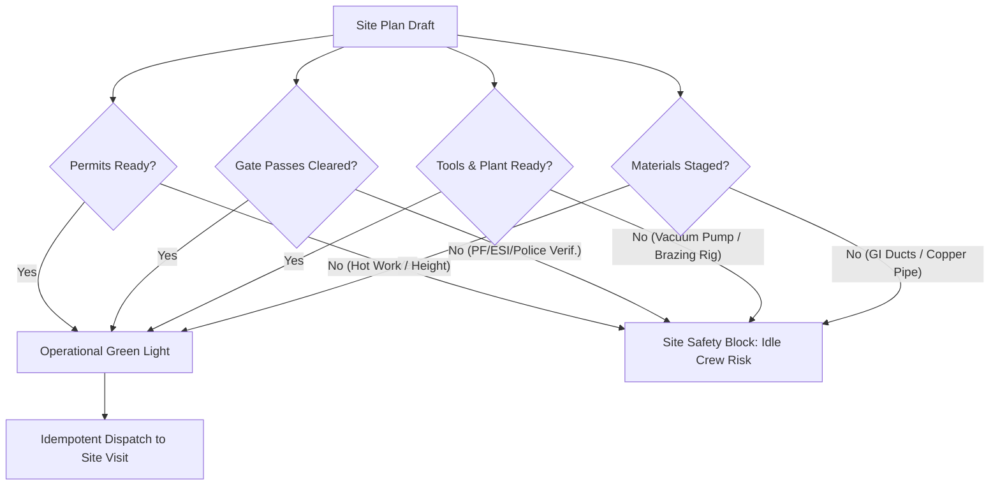

# Operational Head Audit: Site Plan & Workforce Allocation System
**Domain**: MEP Contracting, HVAC Systems, EPC Projects & Commercial Service Operations  
**Role**: Head of Operations (Projects & Facility Service Engineering)  
**Date**: November 2026  
**Status**: Comprehensive Field & Architecture Audit (Awaiting Approval to Proceed)

---

## 1. Executive Summary & Operational Context

In a dual-model enterprise combining **EPC Contracting (large-scale MEP/HVAC installation & erection)** and **Commercial Facility Services (24/7 Breakdown & AMC Maintenance)**, workforce scheduling is the financial and operational heartbeat of the company. 

On an average morning between 06:30 AM and 08:30 AM, an Operational Head faces dozens of high-stakes logistical questions:
- *"Can we dispatch 6 certified duct erectors and 2 copper brazers to the DLF CyberCity tower tomorrow?"*
- *"Client at the airport terminal demands Sunday night testing for fire hydrants. Do we have gate-passed technicians with height work safety inductions?"*
- *"A 500-TR centrifugal chiller tripped at a financial data center under a 2-hour SLA. Who is the closest qualified HVAC controls engineer, and how do we divert them without stalling an ongoing installation?"*
- *"Subcontractor 'Vortex Ducting' promised 12 fabricators today, but only 5 cleared security. How do we redistribute helper manpower to avoid delay penalties (Liquidated Damages)?"*

This audit reviews the current Site Plan web workspace (`apps/web/src/features/site-planning/`), mobile app (`apps/mobile/src/screens/SitePlanMobile.tsx`), and database backend from the vantage point of daily operational reality on the desk and in the field.

---

## 2. Positives: What Works Well & Operational Strengths

The implementation establishes several strong architectural and procedural foundations that align well with rigorous industrial operations:

### 1. Decoupled 3-Dimensional Lifecycle
* **Operationally Sound**: Keeping `plan_status` (internal managerial review), `client_confirmation_status` (client readiness/agreement), and `execution_status` (dispatch/completion) strictly separated is essential.
* **Field Value**: In MEP contracting, an engineering manager may approve a duct installation plan on Tuesday, but the client civil contractor has not poured the concrete slab or cleared scaffolding. Decoupling ensures internal approvals are not clobbered or falsely invalidated when a client requests a postponement.

### 2. Idempotent Execution Dispatch with Row-Level Locking
* **Technical Rigor**: The PostgreSQL RPC `link_or_create_execution_visit()` with `SELECT ... FOR UPDATE` prevents race conditions.
* **Field Value**: Field supervisors frequently operate in basements, plant rooms, or remote construction sites with unstable 3G/4G connectivity. When a supervisor repeatedly taps "Dispatch" due to lag, the backend guarantees that exactly **one** canonical `site_visits` record is linked, preventing duplicate work orders, split billing, and conflicting service tickets.

### 3. Immutable Rescheduling History & Justification
* **Contractual Protection**: Storing date movements in `site_plan_schedule_history` with mandatory postponement reasons and explicit `client_agreed` boolean flags provides legal defense against Liquidated Damages (LD) claims. When clients claim the MEP contractor delayed handover, this audit log provides an immutable record of client-requested hold-ups.

### 4. Tomorrow's Manpower Summary by Trade
* **Morning Briefing Ready**: The aggregation in `TomorrowsManpowerSummary.tsx` grouped by trades (HVAC, Electrical, Plumbing, Firefighting) directly answers the supervisor's morning question: *"What is our net skill surplus or deficit for tomorrow across all sites?"*

### 5. Unified Mobile Parity and Capacitor Sync
* **Field Portability**: Mobile execution (`SitePlanMobile.tsx`) follows the dark-mode glassmorphism design tokens without bloated dependencies, and Capacitor synchronizes reliably with native Android builds.

---

## 3. UX / UI Friction Points (Desk & Field Realities)

### 1. Subcontractor Allocation is a Free-Text Blind Spot
* **Friction**: In `ManpowerAllocationEditor.tsx`, selecting "Subcontractor" prompts for a free-text string (`Crew: Dynamic Ducting`), writing to `notes` while leaving `subcontractor_id` as `null`.
* **Operational Impact**: In MEP projects, 40% to 70% of site labor is supplied by licensed labor subcontractors with contracted man-day unit rates and work orders. Storing subcontractor names as untyped text breaks vendor cost rollups, prevents verification against active vendor POs, and allows supervisors to enter arbitrary crew names that finance cannot reconcile.

### 2. Zero Visual Warnings for Technician Double-Booking
* **Friction**: If a technician (`Rajesh Kumar`) is allocated to Project Alpha on 2026-11-15, the allocation modal still allows him to be assigned to Project Beta on the exact same date without a warning badge or collision alert.
* **Operational Impact**: Operational heads cannot remember the deployment of 50+ technicians across 15 sites. Without real-time conflict indicators, "ghost allocations" occur, resulting in unmanned job sites on the morning of execution.

### 3. Date Handling Vulnerability in Morning Planning Hours
* **Friction**: In `SitePlanForm.tsx` (line 69), `new Date().toISOString().split('T')[0]` is used as the fallback date.
* **Operational Impact**: Operational Heads in India Standard Time (IST, UTC+5:30) plan daily dispatches between 05:00 AM and 05:30 AM. In this window, `toISOString()` rolls back to the previous day (UTC), accidentally creating site plans backdated to yesterday.

### 4. Disconnected Single-Day Workflow for Multi-Week EPC Installations
* **Friction**: Site planning is structured strictly as single-day events (`plan_date`).
* **Operational Impact**: Running 400 meters of chilled water piping takes 18 days. Having to manually create 18 individual single-day plans for the same crew is tedious and leads supervisors to abandon the software in favor of offline Excel sheets.

### 5. Absence of Bulk Crew Assignment ("Gang Copying")
* **Friction**: In MEP erection, technicians work in established teams (e.g., 1 Lead Welder, 2 Fabricators, 3 Helpers). In `ManpowerAllocationEditor.tsx`, every worker must be added individually through repeated modal clicks.
* **Operational Impact**: Allocating a standard 10-man gang across 4 projects requires 40 individual form submissions.

---

## 4. Missing Features (Crucial MEP, HVAC & EPC Realities)

Real-world MEP/HVAC construction and service cannot safely execute on manpower allocations alone. Four critical dependencies are currently absent from the system:



### 1. Permit to Work (PTW) Compliance Gate
* **The Reality**: In commercial buildings, IT parks, and airports, an MEP team cannot strike a single arc or climb scaffolding without client-approved permits:
  * **Hot Work Permit**: Mandatory for copper oxy-acetylene brazing, MIG/TIG welding of fire lines.
  * **Height Work Permit**: Mandatory for duct hanging or cable ladder installation above 1.8 meters.
  * **Confined Space Permit**: Mandatory for AHU chambers, service tunnels, and lift shafts.
* **Missing Feature**: A structured checklist on the Site Plan indicating whether required permits have been applied for, approved, or are pending client signature. Dispatching a crew without an approved permit results in the client safety officer expelling the team and imposing immediate safety violation penalties.

### 2. Gate Pass & Labor Security Compliance Status
* **The Reality**: Major tech parks (DLF, Embassy, Prestige, RMZ) require security clearance 24 to 48 hours prior to entry: ESI/PF registration cards, Government photo ID, and site-specific safety induction certificates.
* **Missing Feature**: A flag indicating whether allocated personnel have cleared client site induction. Allocating un-inducted labor means workers sit outside the security gate for half the shift.

### 3. Tools & Plant (T&P) Equipment Dependencies
* **The Reality**: Skilled labor is useless without specialized MEP machinery.
  * *HVAC Chiller/VRF work*: Requires nitrogen flushing cylinders, two-stage rotary vacuum pumps, digital manifold gauges, refrigerant charging scales.
  * *Electrical installation*: Requires hydraulic crimping tools (up to 400 sq mm), 5kV Megger insulation testers, earth resistance testers.
  * *Plumbing & Fire*: Requires grooving machines, pipe threading machines, hydrostatic pressure testing rigs.
* **Missing Feature**: Tools/machinery reservation attached to the Site Plan. If two teams are scheduled for pressure testing on the same day but the company owns only one calibrated hydrostatic test pump, one site will stand idle.

### 4. Material Staging & Delivery Readiness Gate
* **The Reality**: Before sending 6 ductmen to erect supply air ducts on the 4th floor, the fabricated sheet metal ducts and hanging accessories (threaded rods, unistruts, anchor fasteners) must already be delivered to the site laydown area.
* **Missing Feature**: A "Materials at Site" indicator linked to procurement/dispatch status.

### 5. Service Breakdown vs. EPC Project Milestone Mode
* **The Reality**: 
  * **Emergency Service Calls**: Driven by ticket IDs, asset equipment tags (e.g., *Chiller #02, Model R134a*), contractual SLA countdown timers (e.g., 4-hour restore), and warranty/AMC coverage.
  * **EPC Projects**: Driven by Bill of Quantities (BOQ) line items, floor/zone tags, and drawing revision numbers.
* **Missing Feature**: The current form uses a single generic `trade` dropdown without distinguishing between a time-critical Emergency Service Breakdown and a scheduled Capital Project Erection milestone.

---

## 5. Security Gaps & Technical Bugs Discovered During Audit

> [!CAUTION]
> **P0 Architectural Defect: Dual-Table Data Splitting**  
> In `apps/web/src/features/site-planning/api/sitePlanApi.ts` (lines 5-39 & 136-230) and `apps/mobile/src/screens/SitePlanMobile.tsx`, the API queries `manpower_attendance` where `entry_kind = 'PLANNED'`. If rows exist in that table, it returns **only** those rows and bypasses `site_plans` entirely!  
> However, `createSitePlan` writes to the `site_plans` table unless a `labour_category_id` is supplied. This means site plans created via the standard Web Workspace will vanish from both the calendar and table as soon as any planned labour entry is recorded in the parallel table.

### 1. Incomplete Foreign Key Linkage in Allocations
* **Issue**: `site_plan_allocations` in the database defines a foreign key `subcontractor_id REFERENCES subcontractors(id)`.
* **Vulnerability**: The UI code writes subcontractor names into `notes` while leaving `subcontractor_id` NULL. This disables relational integrity, prevents cascading organization-level security checks, and circumvents reporting.

### 2. Client-Side Only Authorization Guards
* **Issue**: Action triggers in `SitePlanDetailPanel.tsx` (such as "Approve", "Reschedule", "Dispatch", and "Delete") lack granular UI-level Role-Based Access Control (RBAC) gates based on user roles (`SiteEngineer`, `ProjectManager`, `Technician`).
* **Vulnerability**: While PostgreSQL RLS protects table data, non-managerial users have interactive access to mutation triggers, creating confusing UI error toasts when server-side policies reject their requests.

---

## 6. Pragmatic Improvisations (Quick Wins)

These focused enhancements improve field usability without requiring massive schema redesigns:

| Enhancement | Operational Justification | Implementation Path |
|---|---|---|
| **1. Relational Subcontractor Dropdown** | Replaces untyped text with approved vendor master records for cost tracking. | Wire `useSubcontractors()` into `ManpowerAllocationEditor.tsx` and bind to `subcontractor_id`. |
| **2. Inline Double-Booking Warning** | Prevents assigning the same technician to multiple sites on the same calendar day. | Add client-side check in `ManpowerAllocationEditor` comparing `employee_id` and `plan_date` across active plans. |
| **3. Employee Trade & Skill Tagging** | Prevents assigning an apprentice helper to a high-voltage HT termination job. | Render employee designation/trade badge in the allocation selection menu. |
| **4. Recurring Plan Duplicator** | Allows an EPC site manager to schedule a 10-day duct installation block in one pass. | Add a "Repeat for N days" option in `SitePlanForm.tsx` that batch-inserts consecutive daily records. |
| **5. Timezone Construction Correction** | Eliminates early-morning date slippage for operations teams working at 05:00 AM IST. | Replace remaining `toISOString().split('T')[0]` calls in form fallbacks with `formatLocalDate()`. |

---

## 7. "It Would Be MVP" Features (High-Leverage Additions)

To elevate this module from a basic scheduling list into an indispensable field operations command center, three high-leverage additions are recommended:

### Feature A: The "Site Readiness 4-Point Pill"
Add four lightweight boolean checkboxes to each Site Plan:
1. `[✓] Site Clear & Access Granted`
2. `[✓] Hot Work / Height Permit Approved`
3. `[✓] Materials Staged at Site`
4. `[✓] Tools & Equipment Dispatched`

*Display*: On both calendar cards and table rows, render a small traffic-light indicator:
- **Green (4/4)**: Cleared for Dispatch.
- **Amber (1-3/4)**: Blockers Present (hover shows missing items, e.g., "Missing Hot Work Permit").
- **Red (0/4)**: High Idle Labor Risk.

### Feature B: 1-Click WhatsApp / SMS Crew Briefing Generator
Field laborers and subcontractors in India do not monitor web dashboards or push notifications; their operations run on WhatsApp groups.
* **Mechanism**: A "Copy Crew Briefing" button on the Site Plan that copies structured text formatted for mobile messaging:
  ```text
  🏗️ SITE DISPATCH BRIEFING
  Project: Prestige Tech Cloud - Tower B (HVAC Riser)
  Date: 12-Nov-2026 | Shift: 08:30 AM - 05:30 PM
  Site Supervisor: Rajesh Kumar (+91 98401 XXXXX)
  Client Contact: Mr. Sharma (L&T Site In-Charge)

  🛠️ Work Scope: 14" Chilled Water Header Brazing & Flange Bolting
  📋 Permits: Hot Work Permit #HW-409 Approved (Valid till 6 PM)

  👷 Allocated Crew (5):
  - Rajesh Kumar (Lead Welder)
  - Senthil Nathan (Fitter)
  - Anand M. (Fitter)
  - Murugan K. (Helper)
  - Subcontractor: Vortex Ducting (2 Helpers)

  ⚠️ Mandatory PPE: Helmet, Safety Harness, Leather Spats & Face Shield.
  ```

### Feature C: Fast Mobile "Muster-Roll Check-In"
Instead of requiring supervisors to open a detailed modal per worker:
* On `SitePlanMobile.tsx`, display an actionable check-in row at 08:00 AM on the scheduled date:
  `[✓ Mark 4/4 Present]` or `[Adjust Absence]`.
* Tapping it confirms planned labor into actual attendance with a single click, instantly closing the loop between planning and daily site execution.

---

## 8. Prioritized Recommendation Roadmap

```mermaid
flowchart LR
    subgraph Track 1: P0 Fixes
        T1A[Resolve Dual-Table Split] --> T1B[Fix Form Date Drift]
        T1B --> T1C[Bind Relational Subcontractors]
    end
    subgraph Track 2: Operational High Value
        T2A[Readiness 4-Point Checks] --> T2B[Double-Booking Collision Alert]
        T2B --> T2C[WhatsApp Briefing Generator]
    end
    subgraph Track 3: Advanced Field Intelligence
        T3A[Multi-Day Gantt / Bulk Gang Copy] --> T3B[Mobile Fast Muster Check-In]
    end
    Track 1 --> Track 2 --> Track 3
```

1. **Step 1 (Immediate Architectural Safeguard)**:
   Harmonize `site_plans` and `manpower_attendance` in `sitePlanApi.ts` so plans do not get hidden or split between separate tables.
2. **Step 2 (Operational Usability Quick Wins)**:
   Add the relational subcontractor selector, the double-booking collision alert, and the 1-click WhatsApp crew dispatch briefing.
3. **Step 3 (Field Governance)**:
   Implement the 4-point Site Readiness indicators (Permits, Materials, Gate Pass, Tools) to eliminate idle labor costs.

---
*Report prepared by Operational Engineering Head. Awaiting managerial review and approval to proceed with any code changes.*
